# Livraria Nuvem: comércio conversacional na AWS
**Projeto semestral de Computação em Nuvem: relatório técnico (rascunho)**
Repositório: `github.com/palmeidav/projeto-cc` (privado) · Conta AWS 244736565328 · Novembro de 2026

---

## 1. Resumo

A Livraria Nuvem é um MVP de comércio conversacional. O cliente conversa em linguagem natural com um vendedor de IA
(Amazon Bedrock, Claude Haiku 4.5), que consulta catálogo e estoque **por funções reais da aplicação** (tool use da
Converse API) e registra o pedido no banco. O pedido é confirmado de forma assíncrona por um worker que consome uma
fila SQS.

- **Parte 1 (Ohio, us-east-2):** infraestrutura montada **manualmente** (console e CLI) e validada pelos testes da
  Etapa 13: carga, DLQ, idempotência, troca de task e de instância, failover do RDS, falha do LLM e diagnóstico.
- **Parte 2 (São Paulo, sa-east-1):** a mesma solução **reconstruída do zero com Terraform**: 125 recursos, estado
  remoto em S3, código parametrizado por região e provado sem dependências de Ohio.

| Indicador | Resultado |
|---|---|
| Jornada completa (conversa → pedido CONFIRMED) | Ohio ~1 s · SP **201 ms** e **223 ms** (criação → confirmação) |
| Vazão sob carga (Ohio, 80 conexões, LLM em mock) | **234,5 req/s**, p95 672 ms, 0,001% de erro |
| Elasticidade | tasks **2 → 6 → 2** (chat e catalog), instâncias **3 → 4 → 3** |
| Disponibilidade durante trocas | 220/220 (troca de task), **510/510** (refresh das instâncias), **105/105** (rolling deploy em SP) |
| Failover do RDS Multi-AZ | `/health` 133/133; só o `/ready` ficou fora ~15 s |
| Falha do LLM | 5/5 respostas amigáveis, **0 pedidos inconsistentes** |
| Diagnóstico pela observabilidade | causa raiz localizada em **~2 min** |
| Portabilidade | 191 ARNs em sa-east-1, 36 globais, **0 em us-east-2**; o mesmo código planeja 110 recursos em us-east-2 |

---

## 2. Aplicação e decomposição em serviços

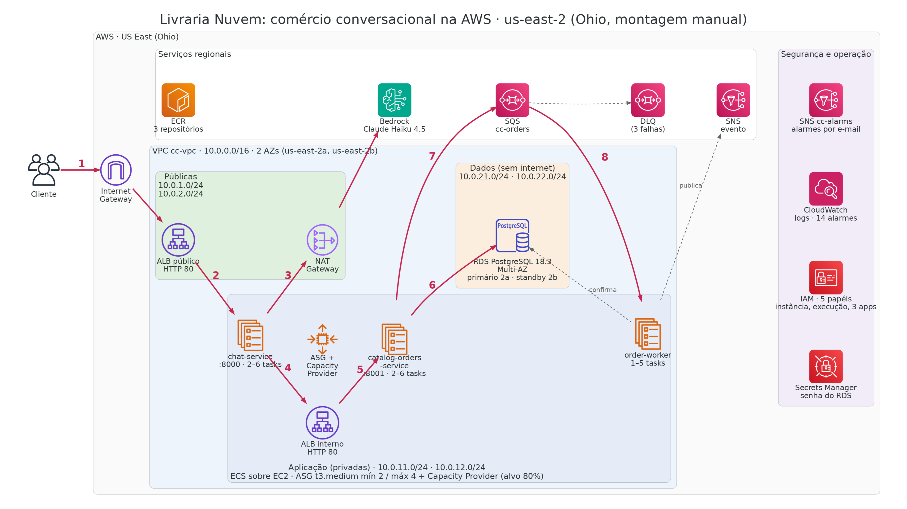

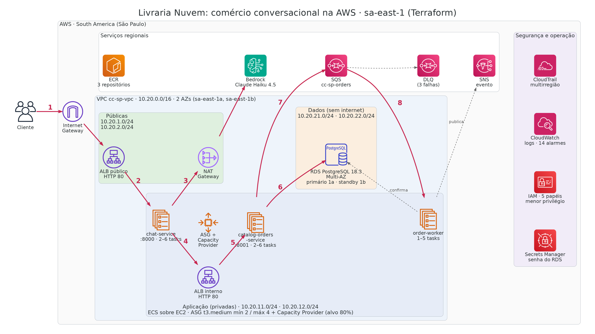

| Serviço | Responsabilidade | Perfil de carga | Escala por |
|---|---|---|---|
| `chat-service` (:8000) | conversa, orquestra o LLM e as ferramentas, guarda o histórico | I/O-bound, dominado pela latência do Bedrock (~1–3 s por turno) | requisições por task no ALB (alvo 600/min) |
| `catalog-orders-service` (:8001) | catálogo, estoque, pedidos, **idempotência** (`Idempotency-Key`) e **outbox** | CPU e banco, chamadas curtas | CPU média (alvo 60%) |
| `order-worker` | consome o SQS, confirma o pedido (**idempotente**) e publica no SNS | assíncrono, por rajadas | **backlog por task** (mensagens visíveis ÷ tasks, alvo 5) |

**Por que três serviços:**
- **Isolamento de falhas:** se o Bedrock cai, só o chat degrada; o catálogo e a confirmação seguem funcionando (teste 13.6).
- **Escala independente:** cada serviço escala por uma métrica diferente.
- **Evolução separada:** cada um tem imagem e task definition próprias.

O chat **não acessa as tabelas de pedidos**: fala com o catalog por HTTP, via ALB interno, e é ele que chama as
ferramentas do LLM.

**Caminho de um pedido** (setas 1 a 8 do diagrama):
1. O cliente chega ao ALB público.
2. O ALB entrega ao chat-service.
3. O chat chama o Bedrock (Converse com tools), saindo pelo NAT.
4. O chat chama o ALB interno.
5. O ALB interno entrega ao catalog-orders-service.
6. O catalog grava o pedido e o outbox no RDS, na mesma transação.
7. O catalog publica o evento no SQS.
8. O order-worker consome a mensagem, confirma o pedido no RDS e publica no SNS.

**Comunicação síncrona onde o usuário espera a resposta** (conversa, consulta de estoque, criação do pedido) e
**assíncrona onde dá para absorver atraso e falha** (confirmação). Com o **outbox**, o evento só existe se o pedido foi
gravado, e a confirmação é idempotente. Juntos, garantem **entrega pelo menos uma vez sem pedido duplicado**.

---

## 3. Rede, disponibilidade e balanceamento

- **VPC própria em 2 AZs**, com 3 camadas de sub-redes /24:

  | Camada | Ohio (10.0.0.0/16) | SP (10.20.0.0/16) | Acesso |
  |---|---|---|---|
  | Pública | x.1, x.2 | x.1, x.2 | ALB e NAT |
  | Aplicação | x.11, x.12 | x.11, x.12 | privada, sai pelo NAT |
  | Dados | x.21, x.22 | x.21, x.22 | **sem rota para a internet** |

- **Exposição controlada:** só o ALB público aceita tráfego da internet (porta 80). As instâncias ECS ficam em sub-redes
  privadas, sem IP público.
- **Security groups encadeados por referência, não por IP:**
  - `alb`: 80 a partir da internet;
  - `app`: portas dinâmicas 32768–65535, só a partir do `alb` e do `ilb` (modo bridge);
  - `ilb`: 80, só a partir do `app`;
  - `db`: 5432, só a partir do `app`.
- **Health checks em dois níveis:**
  - `/health` (processo vivo, **sem banco**) é usado pelo ALB e pelo ECS;
  - `/ready` (verifica o banco) é usado no diagnóstico.

  Assim, uma falha do banco não derruba as tasks. No failover do RDS (13.7), o `/health` ficou 133/133 e nenhuma task foi
  reciclada.
- **Endpoint de gateway do S3:** as camadas das imagens do ECR baixam sem passar pelo NAT, o que reduz custo e dependência.
- **Decisão de custo: 1 NAT Gateway** (`single_nat_gateway = true`). Se a AZ do NAT cair, as tasks perdem a saída para
  o Bedrock, mas o restante segue funcionando. Em produção, basta `single_nat_gateway = false` (1 NAT por AZ), uma
  variável do Terraform.

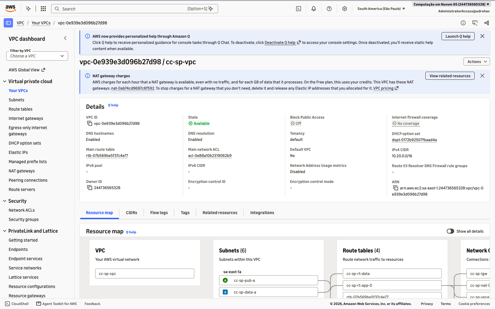

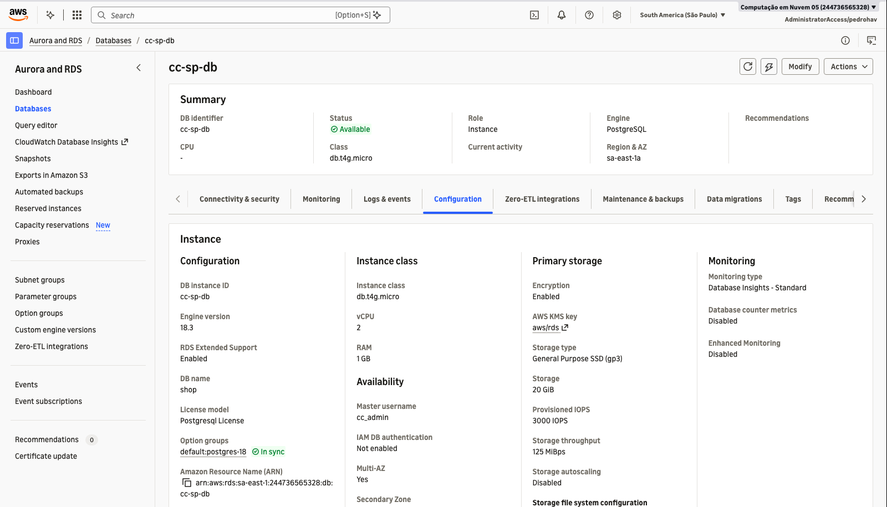

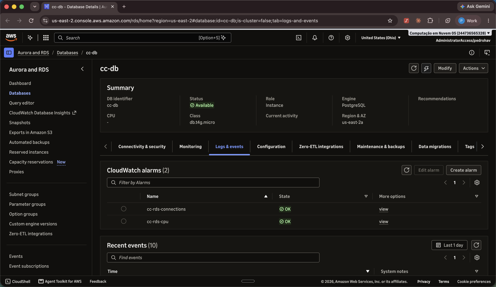

---

## 4. ECS sobre EC2 e gerenciamento de capacidade

- **Launch Template:**
  - AMI ECS-optimized do Amazon Linux 2023, obtida por parâmetro SSM na região do deploy (nenhum ID fixo);
  - t3.medium, IMDSv2 obrigatório;
  - em SP, **tags também nos volumes EBS** (lição da Parte 1).
- **ASG** com mínimo 2, máximo 4, `protect_from_scale_in`.
- **Capacity Provider** com escala gerenciada (alvo **80%**), proteção gerenciada contra término e drenagem gerenciada.
- **Reservas e limites por container:**

  | Serviço | CPU (unid.) | Memória reservada (soft) | Memória máxima (hard) |
  |---|---|---|---|
  | chat | 512 | 512 MiB | 1024 MiB |
  | catalog | 256 | 256 MiB | 512 MiB |
  | worker | 256 | 256 MiB | 512 MiB |

  Uma t3.medium oferece 2048 unidades de CPU e ~3,8 GiB. Com o mínimo de tasks (2 chat, 2 catalog, 1 worker), a reserva
  é de 1792 unidades e 1792 MiB: o conjunto cabe em uma instância, e duas dão redundância. O limite *hard* acima do
  *soft* deixa o chat absorver picos de memória sem reservar o pico o tempo todo.
- **Posicionamento:**
  - chat e catalog usam `spread` por AZ e depois `spread` por instância;
  - o worker usa `spread` por AZ e depois `binpack` por memória;
  - o *AZ rebalancing* do ECS está ligado.

  Na Parte 1, o chat usava `binpack` e as 2 tasks caíram na mesma máquina. A perda dessa máquina derrubou o chat por
  ~18 s (13.4). A correção foi espalhar por instância. Não usamos `distinctInstance` porque ele travaria o chat em 4
  tasks, o máximo do ASG.
- **Folga do alvo de 80%:** com tasks nas 2 instâncias, a ocupação seria 2/2 = 100% > 80%, então o CP mantém uma 3ª
  instância vazia (2/3 = 67%). O custo é ~US$ 1/dia. O ganho é absorver um pico sem esperar uma EC2 subir: no 13.2,
  as 4 tasks novas do chat couberam nessa instância, sem nenhuma task presa esperando capacidade.
- **Achado: espalhar por instância aumenta a frota em uma máquina.** Depois da troca para `spread` por instância, os
  dois ambientes ficaram com **4 instâncias, o máximo do ASG**, mesmo sem carga (Ohio desde 18/11 às 21:11; SP depois do
  rolling deploy). A explicação, conferida em 20/11:
  - as 5 tasks passaram a ocupar **3** instâncias, em vez de 2 com o *binpack*, e cada região tem **1 instância vazia**;
  - o Capacity Provider dimensiona a frota por **N = ⌈instâncias ocupadas ÷ 0,80⌉**: antes ⌈2 ÷ 0,8⌉ = 3, agora
    ⌈3 ÷ 0,8⌉ = **4**;
  - o `CapacityProviderReservation` está em 80, ou seja, o Capacity Provider considera esse tamanho correto.

  É o custo explícito da resiliência: tolerar a perda de uma máquina sem derrubar o chat custa ~US$ 1/dia por região.
  Também significa que, sob carga, **não sobra margem para crescer** (o ASG já está no máximo de 4). Opções:
  - subir o máximo do ASG para 5 ou 6;
  - `targetCapacity = 100`, sem instância de folga;
  - `spread` por instância só no chat, e *binpack* no catalog e no worker.
- **Inclusão, drenagem, substituição e remoção de instâncias, demonstradas:**
  - **Inclusão:** a 4ª instância foi registrada no cluster ~33 s depois do lançamento.
  - **Drenagem e substituição:** o *instance refresh* trocou as 3 instâncias em ~7 min, com 510/510 respostas 200 (13.3).
  - **Remoção segura:** o ASG recusou o scale-in enquanto as instâncias estavam protegidas e só terminou a que o ECS
    esvaziou (achado 5).

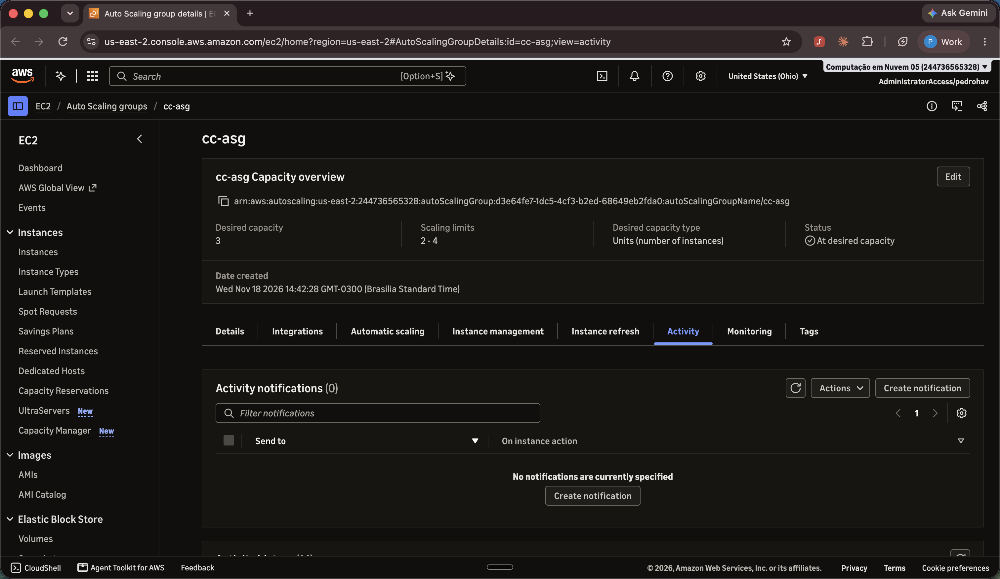

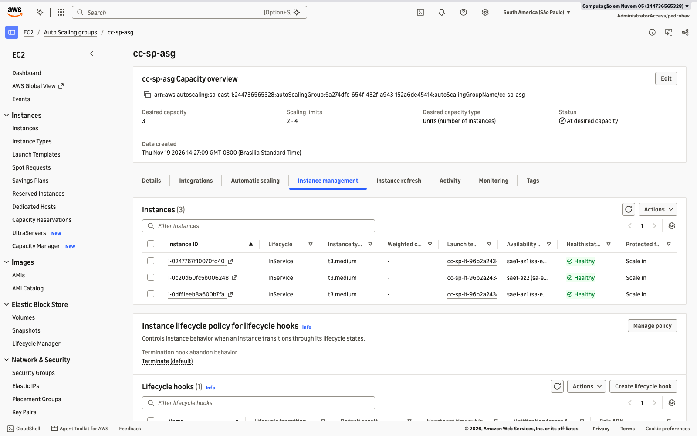

---

## 5. Elasticidade, mensageria e resiliência

**Dois níveis de elasticidade:**
1. **Tasks:** target tracking por serviço (seção 2).
2. **Instâncias:** o Capacity Provider ajusta o ASG pela métrica `CapacityProviderReservation`.

**Carga em Ohio** (hey, 80 conexões, `POST /chat` com o LLM em mock):

| | Carga 1 (5 min) | Carga 2 (10 min) |
|---|---|---|
| Configuração | 2 chat · 2 catalog · 3 EC2 | 6 · 6 · 4 |
| Vazão | **234,5 req/s** | 190,9 req/s |
| Latência p50 / p95 / p99 | 289 ms / 672 ms / 1,43 s | 255 ms / 1,38 s / 2,86 s |
| Erros | 0,001% (1× 502) | 0,002% |
| CPU do RDS / conexões | 45–50% / 41 | **80–85% / 70** |

| Evento de escala | Tempo |
|---|---|
| Reação do target tracking | ~5 min (3 pontos de 1 min mais o atraso da métrica do ALB) |
| Tasks novas healthy | ~58 s |
| Instância nova registrada | ~33 s |
| Scale-in das tasks | 14–18 min |
| Volta a 3 instâncias | ~38 min |

**Análise quantitativa:**
- Escalar de 2 + 2 para 6 + 6 tasks derrubou a CPU das tasks de ~170% para ~47% da reserva, mas a **vazão não subiu**
  (191 req/s contra 234 req/s) e a cauda piorou.
- O gargalo migrou para o **RDS db.t4g.micro**: CPU de 80–85% e **70 conexões, perto do limite de ~80**. Uma task extra
  chegou a falhar ao conectar.
- Conclusões:
  - mais tasks não resolvem quando o banco é o limite;
  - o alarme de conexões foi baixado de 80 para **60**;
  - os próximos passos são um pool menor por task, RDS Proxy ou uma classe maior de banco.
- O alvo do chat foi recalibrado de 50 para **600 req/min por task**. Com 50, os próprios loops de medição escalavam o
  serviço. O valor 600 é ~60% do teto estimado com o Bedrock real: 40 turnos simultâneos de ~2,5 s dão ~960 por minuto.

**Bedrock real:** turno completo de 1,9 a 2,9 s; `LLMLatencyMs` com mínimo de 666 ms, média de ~990 ms e máximo de
1.696 ms.

**Carga curta em SP (20/11, 23:32–23:42 UTC):**
- **Teste:** `hey -z 10m -c 100` no `/health` do chat. Não usa o Bedrock e não exige apply; a métrica de escala do chat
  (requisições por task no ALB) conta qualquer requisição.
- **Vazão:** **274,3 req/s**, com **164.651/164.651 respostas 200**.
- **Latência:** p50 360 ms e p95 377 ms, dominada pela ida e volta Mac → SP (a mais rápida levou 353 ms).
- **Escala das tasks:** o chat foi de **2 para 6** às 23:38:16, ~6 min depois do início, como em Ohio. As **6 tasks
  estavam running e healthy no ALB 23 s depois**.
- **Instâncias:** o `CapacityProviderReservation` foi de 80 para **100** (as 4 instâncias ocupadas), mas o ASG **já estava
  no máximo (4)** por causa do espalhamento por instância (seção 4). Não houve scale-out de EC2, e as tasks novas couberam
  na instância de folga. O scale-out de instâncias está demonstrado em Ohio (3 → 4 → 3).
- **Scale-in:** o chat começou a reduzir ~18 min depois do fim da carga (6 → 5 às 23:59:49 e 5 → 4 às 00:02:38), um
  passo a cada ~3 min por causa do cooldown, igual a Ohio.

**Mensageria e falhas parciais:**
- **Retentativa e DLQ:** a mensagem inválida ("poison") falhou 3 vezes (visibilidade de 60 s) e foi para a DLQ. O alarme
  `cc-dlq-not-empty` foi para ALARM e notificou pelo SNS (13.5).
- **Duplicidade na entrada:** o mesmo `POST /orders` com a mesma `Idempotency-Key` devolveu 201 e depois 200
  (`idempotent_replay`), com um único pedido no banco.
- **Duplicidade na fila:** a mensagem reentregue foi ignorada ("mensagem duplicada ignorada"), com `confirmed_at`
  inalterado.
- **Dependência indisponível:** sem permissão no Bedrock, o chat respondeu de forma amigável (`degraded=true`), sem
  criar pedido, e voltou na mesma conversa assim que a permissão foi restaurada (13.6).

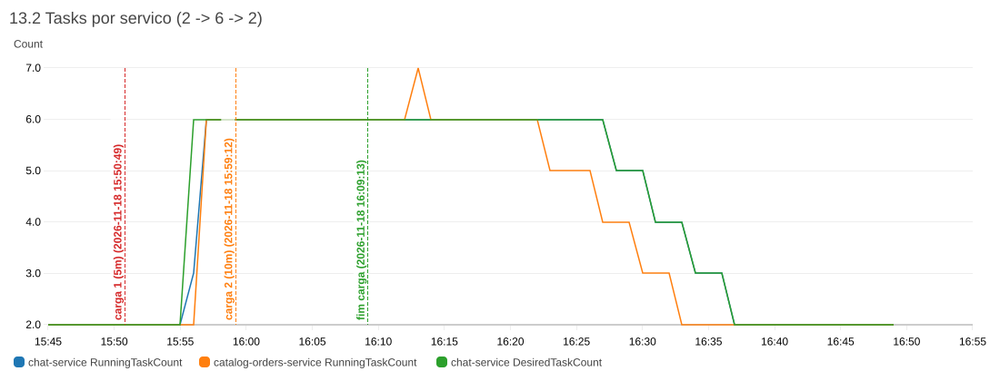

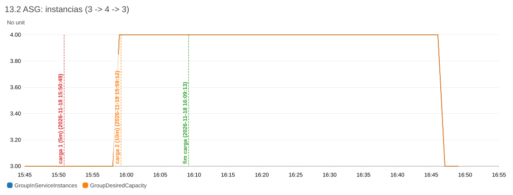

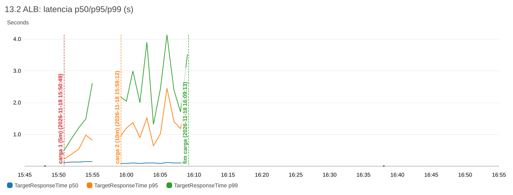

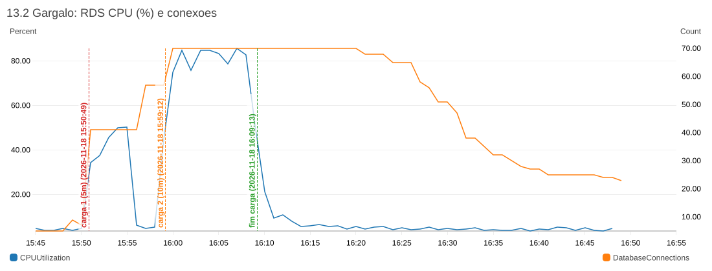

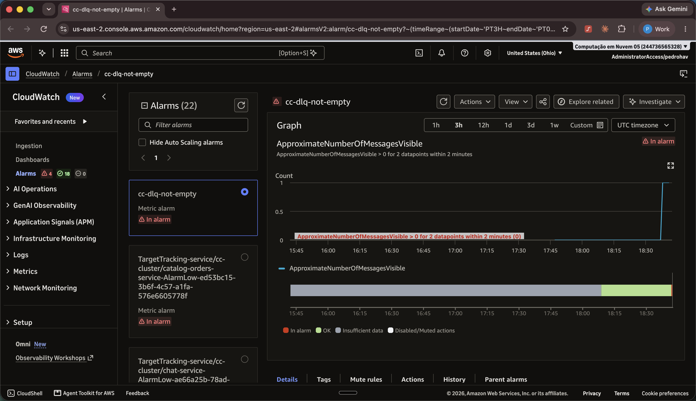

---

## 6. Segurança, observabilidade e operação

**Segredos:**
- A senha do banco é **gerada e guardada pelo próprio RDS no Secrets Manager** (`manage_master_user_password`).
- Ela nunca passa pelo código, pelas imagens, pelo Terraform nem pelo estado. As tasks recebem só o ARN (`secrets.valueFrom`).
- O repositório foi varrido: nenhum ARN de segredo, credencial ou token.

**IAM: 5 papéis distintos, com menor privilégio:**

| Papel | Permissões |
|---|---|
| Instância | ECS e SSM |
| Execução das tasks | ECR, logs e **só o segredo do banco** |
| Chat | `bedrock:InvokeModel` **só no perfil e no modelo do Haiku** (em Ohio era `*`; corrigido em SP) |
| Catalog | `sqs:SendMessage` na fila |
| Worker | consumir a fila e publicar no tópico |

As relações de confiança das tasks têm a condição `aws:SourceAccount`.

**Logs correlacionáveis:**
- Os logs são JSON nos grupos `/cc/<env>/<serviço>`.
- O `conversation_id` acompanha a requisição do chat ao catalog (header `X-Conversation-Id`), ao outbox e ao worker.
- Uma consulta no Logs Insights reconstrói a jornada inteira: chat → "pedido criado" → "pedido confirmado".

**Métricas:**
- **Técnicas:** ALB, ECS/Container Insights, ASG, CapacityProviderReservation, SQS e RDS.
- **De negócio**, publicadas pelo próprio código em EMF: `OrdersCreated`, `OrdersConfirmed`, `OutboxPending`,
  `ChatDegraded`, `LLMLatencyMs` e `AppErrors` (filtro de log).

**Alarmes (14):**

| Tema | Alarmes |
|---|---|
| Tasks | um por serviço |
| Cluster | CPU e memória reservadas |
| ASG | capacidade abaixo do mínimo |
| ALB | 5xx, alvos unhealthy, latência p95 |
| Filas | idade da mensagem mais antiga, DLQ não vazia |
| RDS | CPU e conexões |
| Aplicação | erros |

**Dashboards:** `cc-sp`, com visão geral, e `cc-sp-diagnostico`, que segue o caminho alarme → métricas → logs.

**Diagnóstico demonstrado (13.8):** o alarme de erros disparou ~1m50s depois da falha. O dashboard mostrou erros e chat
degradado, sem latência do LLM, com o ALB e as tasks saudáveis. O Logs Insights por `conversation_id` mostrou o
`AccessDenied` do Bedrock. **Causa raiz em ~2 min**, sem entrar nas máquinas.

**Auditoria (SP):**
- Trilha CloudTrail **multirregião**, com validação de integridade, gravando em S3 privado e no CloudWatch Logs.
- 3 alarmes de auditoria: mudança de IAM, mudança de security group e acesso negado em sequência.
- O histórico de eventos mostra, com usuário e horário, as mudanças de política do teste 13.6.

**Resposta a incidentes:** o `parte2/docs/runbook-incidentes.md` tem severidades, 6 playbooks (Bedrock, DLQ, fila,
alvos/5xx, banco e auditoria) com consultas prontas e um registro pós-incidente.

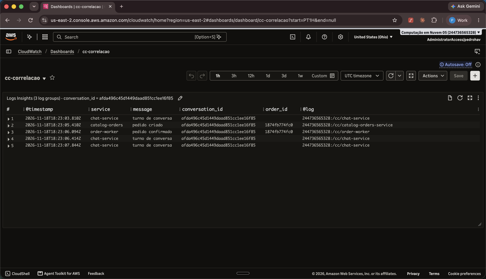

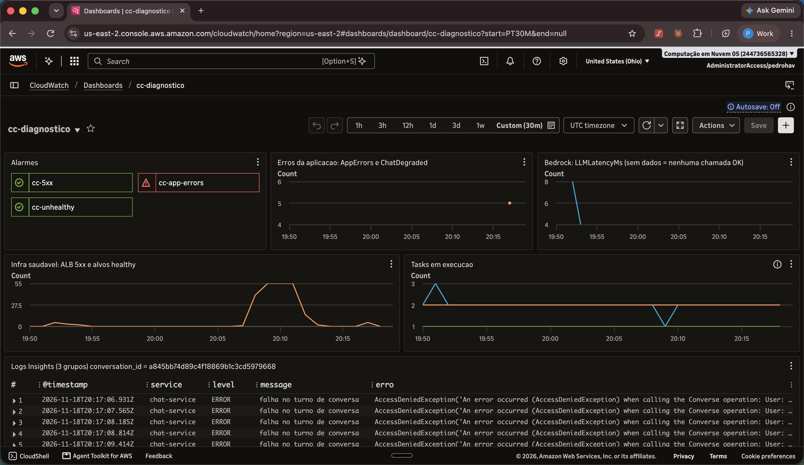

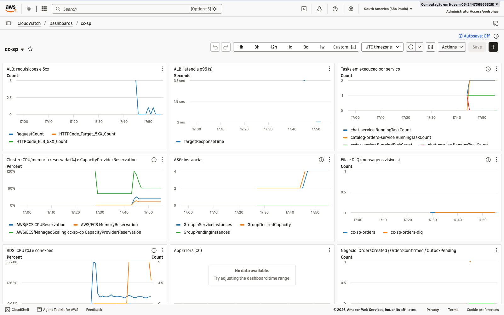

---

## 7. Terraform e portabilidade regional

- **Organização:**
  - `infra/bootstrap`: bucket do estado, com versionamento, criptografia e acesso público bloqueado;
  - 11 módulos: network, security, database, messaging, iam, registry, compute, loadbalancer, observability, audit e
    **service**, um módulo genérico usado 3 vezes;
  - `envs/sa-east-1`: composição dos módulos.
- **Estado remoto e versões:**
  - estado em S3 com **lock nativo** (`use_lockfile`, sem DynamoDB);
  - versões fixadas (Terraform ≥ 1.10, AWS provider ~> 6.0, lock file com hashes para 3 plataformas).
- **Parametrização:**
  - região, prefixo, CIDR, tipo de instância, limites, alvos de escala, modelo do Bedrock e opções do banco;
  - `default_tags` em tudo, e tags explícitas nas instâncias e nos volumes, onde o `default_tags` não chega.
- **Dependências regionais tratadas:**

  | Item | Como é obtido |
  |---|---|
  | AZs | data source |
  | AMI | parâmetro SSM da região |
  | Endpoints | montados com a região corrente |
  | Imagens | **build e push dentro do `apply`**, no ECR da própria região, com tag igual ao hash do código; o SP não depende do ECR de Ohio |
  | Modelo do Bedrock | variável. Em SP só existe o perfil `global.` do Haiku 4.5, verificado na Fase 0 |

  O perfil `global.` pode processar a inferência fora do Brasil. É uma limitação a declarar.
- **Prova de que nada depende de Ohio** (`scripts/prova-sem-ohio.sh`):
  - a busca no código não encontra nenhum valor de Ohio;
  - no estado: 191 ARNs em sa-east-1, 36 globais, 0 em us-east-2;
  - o **mesmo código** com `region=us-east-2` planeja 110 recursos sem alterar arquivos.

  A varredura encontrou **uma dependência escondida**: o código Python tinha `us-east-2` como região padrão. Foi
  removida e publicada por rolling deploy, com 105/105 respostas 200.
- **Problemas reais no primeiro apply, e como foram resolvidos:**
  - colisão no Keychain do macOS com 3 `docker login` em paralelo: resolvida com retentativas;
  - descrição de security group com `>`, que a API recusa: texto trocado.

  O segundo apply completou sem destroy.
- **Ciclo destroy → apply cronometrado: não executado, por decisão de custo e risco.** O ambiente de SP estava em uso
  para as evidências e a apresentação, e recriá-lo custaria mais ~30 min de RDS Multi-AZ, NAT e instâncias, com risco
  perto do prazo. A **criação** completa foi feita e medida (125 recursos; RDS Multi-AZ em 13m36s), e o código já prevê a
  destruição limpa:
  - `skip_final_snapshot` e `deletion_protection = false` no RDS;
  - `force_delete` no ECR e no ASG;
  - `force_destroy` no bucket da trilha;
  - dependências explícitas: os serviços dependem da associação do capacity provider.

  A destruição será feita com `terraform destroy` depois da avaliação.

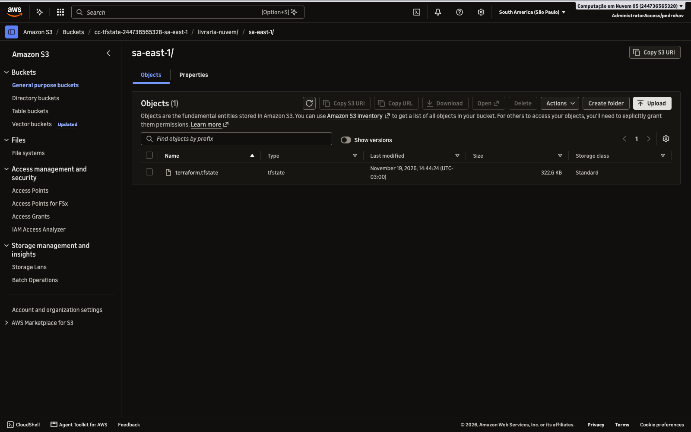

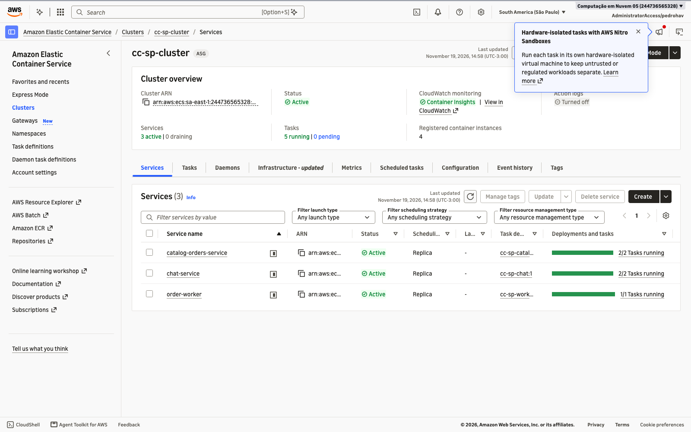

---

## 8. Custos (estimativa)

| Item (por região) | Observação |
|---|---|
| NAT Gateway | cobrado por hora, mesmo sem tráfego; 1 por região |
| 2 ALBs | público e interno |
| RDS db.t4g.micro Multi-AZ | 2 instâncias (primária e standby) |
| 2 a 4 × t3.medium | a 3ª instância é a folga do alvo de 80% |

Total aproximado por região: ~US$ 0,45–0,50/h. Budget de US$ 50/mês com alerta por e-mail. Depois da avaliação, os
ambientes serão destruídos (SP com `terraform destroy`).

---

## 9. Limitações e próximos passos

- **Banco:** o RDS t4g.micro é o gargalo sob carga. Próximos passos: RDS Proxy, pool menor por task ou classe maior.
- **Velocidade de reação:** o target tracking leva ~5 min. Para picos curtos, considerar *step scaling*.
- **Bedrock em SP:** o perfil `global.` pode processar a inferência fora da região.
- **NAT:** um só NAT, por custo, é ponto único para a saída à internet. Em produção, 1 por AZ.
- **Protocolo:** HTTP sem TLS no ALB, por ser laboratório sem domínio próprio. Em produção, ACM com HTTPS.

---

## Anexo A: recursos criados

Listas completas, geradas da AWS em 20/11/2026:

| Região | Fonte | Total | Arquivo |
|---|---|---|---|
| **SP (sa-east-1)**, Terraform | estado remoto (`terraform show -json`) | **125 recursos gerenciados** em 13 módulos | [`recursos-sp.md`](recursos-sp.md) |
| **Ohio (us-east-2)**, manual | API de tags (`project=cc`), IAM e Budget | **86 recursos** (sem os que não aceitam tag: rotas, regras de SG, associações) | [`recursos-ohio.md`](recursos-ohio.md) |

Principais componentes em cada região:
- **Rede:** 1 VPC, 6 sub-redes, IGW, 1 NAT com EIP, 3 tabelas de rotas e endpoint S3.
- **Security groups:** 4.
- **Balanceamento:** 2 ALBs, 2 target groups e 2 listeners.
- **Computação:** 1 cluster ECS, Launch Template, ASG, Capacity Provider, 3 serviços e 3 task definitions.
- **Imagens:** 3 repositórios ECR.
- **Banco:** RDS Multi-AZ com subnet group, e o segredo gerenciado.
- **Mensageria:** SQS com DLQ e 2 tópicos SNS.
- **IAM:** 5 papéis e 1 instance profile.
- **Observabilidade:** 3 log groups, 3 filtros de métrica, 14 alarmes e 2 dashboards.
- **Só em SP:** trilha CloudTrail com bucket, log group, papel e 3 alarmes de auditoria; bucket do estado do Terraform.

## Anexo B: onde estão as evidências
- Ohio: `evidencias-etapa13/RESUMO.md` (testes 13.1–13.8, prints em `evidencias-etapa13/prints/`)
- SP: `parte2/evidencias-parte2/RESUMO.md` (plans, applies, jornadas, deploy, portabilidade, auditoria, prints)

---

## Referências

### Material da disciplina
1. INSPER. *Projeto Semestral: Plataforma de Comércio Conversacional na AWS*. Especificação do projeto e rubrica de avaliação. Computação em Nuvem, 2026.
2. INSPER. *Roteiro da Parte 1: construção manual na AWS (Ohio, us-east-2)*. Computação em Nuvem, 2026.
3. INSPER. *Guia do projeto: Parte 1* e *Demonstração do nível B (MVP)*. Computação em Nuvem, 2026.

### Documentação oficial
4. AMAZON WEB SERVICES. *Amazon ECS Developer Guide: Amazon EC2 Auto Scaling group capacity providers*. Disponível em: https://docs.aws.amazon.com/AmazonECS/latest/developerguide/asg-capacity-providers.html
5. AMAZON WEB SERVICES. *Amazon ECS Developer Guide: task placement strategies*. Disponível em: https://docs.aws.amazon.com/AmazonECS/latest/developerguide/task-placement-strategies.html
6. AMAZON WEB SERVICES. *Application Auto Scaling User Guide: target tracking scaling policies*. Disponível em: https://docs.aws.amazon.com/autoscaling/application/userguide/application-auto-scaling-target-tracking.html
7. AMAZON WEB SERVICES. *Elastic Load Balancing: Application Load Balancers*. Disponível em: https://docs.aws.amazon.com/elasticloadbalancing/latest/application/introduction.html
8. AMAZON WEB SERVICES. *Amazon RDS User Guide: Multi-AZ DB instance deployments*. Disponível em: https://docs.aws.amazon.com/AmazonRDS/latest/UserGuide/Concepts.MultiAZ.html
9. AMAZON WEB SERVICES. *Amazon RDS User Guide: password management with Amazon RDS and AWS Secrets Manager*. Disponível em: https://docs.aws.amazon.com/AmazonRDS/latest/UserGuide/rds-secrets-manager.html
10. AMAZON WEB SERVICES. *Amazon SQS Developer Guide: dead-letter queues*. Disponível em: https://docs.aws.amazon.com/AWSSimpleQueueService/latest/SQSDeveloperGuide/sqs-dead-letter-queues.html
11. AMAZON WEB SERVICES. *Amazon CloudWatch: Embedded Metric Format*. Disponível em: https://docs.aws.amazon.com/AmazonCloudWatch/latest/monitoring/CloudWatch_Embedded_Metric_Format.html
12. AMAZON WEB SERVICES. *Amazon Bedrock User Guide: Converse API* e *cross-Region inference*. Disponível em: https://docs.aws.amazon.com/bedrock/latest/userguide/conversation-inference.html e https://docs.aws.amazon.com/bedrock/latest/userguide/cross-region-inference.html
13. AMAZON WEB SERVICES. *AWS CloudTrail User Guide*. Disponível em: https://docs.aws.amazon.com/awscloudtrail/latest/userguide/cloudtrail-user-guide.html
14. AMAZON WEB SERVICES. *AWS Well-Architected Framework*. Disponível em: https://docs.aws.amazon.com/wellarchitected/latest/framework/welcome.html
15. HASHICORP. *Terraform: backend S3* e *AWS Provider*. Disponível em: https://developer.hashicorp.com/terraform/language/backend/s3 e https://registry.terraform.io/providers/hashicorp/aws/latest/docs

### Padrões e boas práticas
16. RICHARDSON, C. *Pattern: Transactional outbox*. microservices.io. Disponível em: https://microservices.io/patterns/data/transactional-outbox.html
17. IETF. *The Idempotency-Key HTTP Header Field* (Internet-Draft, HTTPAPI Working Group). Disponível em: https://datatracker.ietf.org/doc/draft-ietf-httpapi-idempotency-key-header/
18. CENTER FOR INTERNET SECURITY. *CIS Amazon Web Services Foundations Benchmark*. Disponível em: https://www.cisecurity.org/benchmark/amazon_web_services

### Ferramentas
19. FastAPI (https://fastapi.tiangolo.com), psycopg 3 (https://www.psycopg.org) e boto3 (https://boto3.amazonaws.com/v1/documentation/api/latest/index.html): código dos serviços.
20. hey: gerador de carga HTTP. Disponível em: https://github.com/rakyll/hey
21. Diagrams: diagramas como código com ícones oficiais da AWS. Disponível em: https://diagrams.mingrammer.com

### Uso de inteligência artificial
- **Como componente do produto:** o vendedor da Livraria Nuvem é o modelo **Claude Haiku 4.5 (Anthropic)**, acessado pelo **Amazon Bedrock** com a Converse API e uso de ferramentas (tool use). A IA consulta o catálogo e registra pedidos por funções reais da aplicação.
- **Como apoio ao desenvolvimento:** o grupo usou o **Claude Code (Anthropic)**, um assistente de programação com IA, para:
  - montar e conferir a infraestrutura pela AWS CLI;
  - executar os testes da Etapa 13 e coletar as evidências;
  - escrever os módulos Terraform e os scripts de apoio;
  - gerar os diagramas;
  - redigir o rascunho deste relatório.
- **Validação humana:** todas as ações na conta AWS foram autorizadas pelo grupo, e os números citados vêm dos logs, métricas e arquivos de evidência guardados no repositório (`evidencias-etapa13/` e `parte2/evidencias-parte2/`). As decisões de arquitetura, a revisão do conteúdo e a apresentação são de responsabilidade do grupo.
